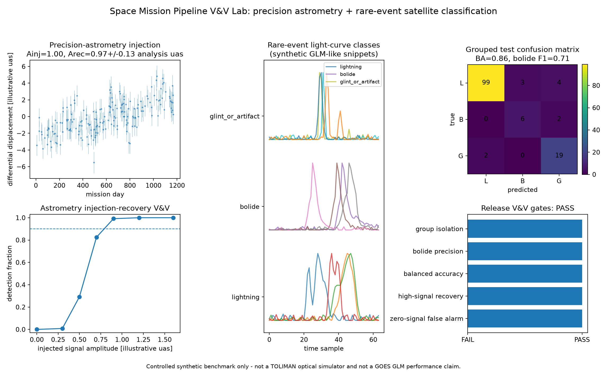

# space-mission-pipeline-vv-lab

[](https://github.com/pkd-45/space-mission-pipeline-vv-lab/actions/workflows/tests.yml)

**A compact synthetic verification-and-validation benchmark for precision astrometry and rare-event satellite pipelines.**

This independent benchmark explores two distinct scientific pipeline problems through a common, reproducible verification-and-validation workflow:

1. a differential-astrometry injection-recovery workflow with nuisance regression and model comparison;
2. an imbalanced light-curve classification workflow with group-safe validation, calibration and human-review ranking.

It is **not TOLIMAN mission software**, **not a TOLIMAN optical simulator**, does not use proprietary mission data, and does not claim performance on GOES GLM observations.

## Why this project

Both precision astrometry and rare-event time-series classification depend on explicit instrument/nuisance models, science-aware validation, documented quality thresholds, and traceable results. This repository implements those practices across two controlled synthetic examples.

## End-to-end structure

```text
precision-astrometry track                 rare-event satellite track
--------------------------                 --------------------------
mission cadence + nuisance channels        grouped light-curve snippets
thermal / pointing / PSF terms             lightning / bolide / artifact
              |                                         |
              v                                         v
weighted nuisance regression                interpretable time/geospatial features
null vs periodic signal model               class-balanced gradient boosting
              |                                         |
              v                                         v
BIC + amplitude uncertainty                 calibration + confusion matrix
injection-recovery curve                    human-review candidate ranking
              \____________________  ___________________/
                                   \/
                        shared V&V gates + SHA-256 manifest
```

## Reference output



The figure shows a microarcsecond-scale *analysis-unit* astrometric example, an injection-recovery curve, representative synthetic light curves, a grouped test confusion matrix and release gates. These are controlled software-validation results only.

## Quick start

Use Python 3.11-3.13:

```bash
chmod +x run_tests_macos.sh
PYTHON_BIN=python ./run_tests_macos.sh
```

Or:

```bash
python3.12 -m venv .venv
source .venv/bin/activate
python -m pip install -e '.[dev]'
pytest -q
space-mission-vv --config configs/demo.json
```

## Products

The demo writes:

- `reference_metrics.json`;
- `astrometry_recovery.csv`;
- `bolide_candidate_ranking.csv`;
- `space_mission_pipeline_vv_summary.png`;
- `product_manifest.json` with SHA-256 provenance.

## Validation principles

- deterministic reference configuration;
- injection-recovery rather than a single example;
- explicit nuisance variables;
- null/full model comparison;
- group-safe split to prevent operational leakage;
- balanced accuracy and class-specific precision/recall;
- probability calibration through Brier score;
- traceable candidate ranking for human review;
- product hashes and release gates;
- explicit separation between prototype evidence and mission claims.

See [`docs/ROLE_MAPPING.md`](docs/ROLE_MAPPING.md) and [`docs/VALIDATION.md`](docs/VALIDATION.md).

## How it complements my existing repositories

- [`radio-pipeline-control-lab`](https://github.com/pkd-45/radio-pipeline-control-lab): retries, restart/resume, checksums, telemetry, SQLite state, quality gates and Slurm planning.
- [`ml-radio-recon`](https://github.com/pkd-45/ml-radio-recon): interferometric forward modelling, CLEAN, metadata-aware U-Net/Transformer reconstruction and anomaly detection.
- [`dsa-hi-survey-ops`](https://github.com/pkd-45/dsa-hi-survey-ops): spectral-cube processing, RFI-aware choices, source finding and injection-recovery QA.
- [`radio-signal-intelligence-lab`](https://github.com/pkd-45/radio-signal-intelligence-lab): compact multimodal classification and transparent candidate triage.

Together, these projects explore numerical modelling, image/time-series ML, mission-style V&V, reliable execution and scientific product QA.

## Author

Pratyush Kumar Das - PhD candidate in astrophysics, The University of Queensland  
ORCID: 0000-0002-4326-8598
